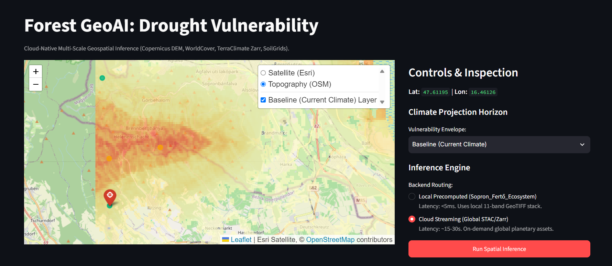
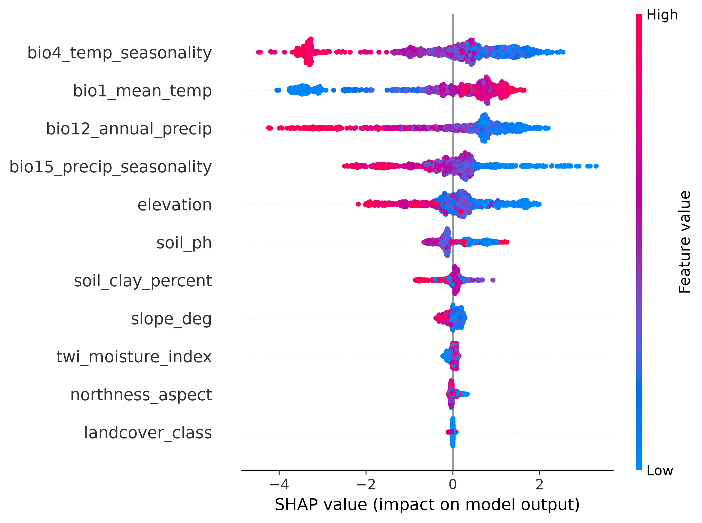

# Forest Vulnerability to Hotter Droughts: Multi-Scale Cloud-Native GeoAI Pipeline

[](https://github.com/DanilKras/ArmillariaGeoAIPipeline/actions/workflows/ci.yml)
[](https://www.python.org/)
[](https://dvc.org/)
[](LICENSE)

An end-to-end, configuration-driven Geospatial Machine Learning pipeline designed to quantify, explain, and project **forest ecosystem vulnerability to hotter droughts and compound climate extremes** (focusing on Norway spruce, *Picea abies*). 

The architecture bridges the scale gap by uniting **macro-scale regional bioclimatic vulnerability modeling (30 m)** with **micro-scale individual crown stress and canopy dieback diagnostics (1 m)**. It leverages cloud-native STAC catalogs, multi-dimensional Zarr climate cubes, UAV LiDAR 3D structure, and cross-attention multi-sensor fusion, evaluated under rigorous spatial cross-validation to eliminate spatial autocorrelation leakage.

---

## Interactive Dashboard & Model Attribution

| Real-Time Spatial Risk & SHAP Attribution | Global Factor Attribution (SHAP Beeswarm) |
| :---: | :---: |
|  |  |

> 🔗 **Video Walkthrough:** [Project Demonstration Video](https://drive.google.com/file/d/1ZfSfTBwKpOTrdrGbKoAzGnVFcybMXxF1/view?usp=sharing)

---

## Key Achievements & Benchmarks

- **Macro Spatial Generalization (ROC-AUC: 0.955 ± 0.017):** Spatially honest evaluation via 5-fold Spatial Block `GroupKFold` (150 km blocks determined by empirical semivariograms of terrain and climate), guaranteeing zero spatial data leakage across European biomes.
- **Physical Ground Truth Grounding:** Binary vulnerability targets stratified via empirical **Climatic Water Deficit ($\text{CWD} = \text{PET} - \text{PPT}$)** during the catastrophic 2018 European mega-drought using TerraClimate Zarr multidimensional arrays.
- **Micro-Scale Multi-Sensor Fusion (ROC-AUC: 0.88, PR-AUC: 0.34):** Cross-Attention Transformer fusing 3D UAV LiDAR geometry (1 m CHM) and ultra-high-resolution orthophotos (20 cm) with Sentinel-1 SAR (dielectric canopy moisture) and Sentinel-2 spectral time series across 640,000 individual tree crowns.
- **Robust Weak Supervision:** Overcomes ground-truth scarcity via allometric LiDAR crown-to-height scaling proxies ($Z\text{-score} < -1.65$, 4.8% prevalence), outperforming the random baseline by >7× on PR-AUC.
- **Dual-Engine Inference Backend:** 
  - **Local Edge Engine:** Sub-5ms spatial inference utilizing local precomputed 11-band GeoTIFF stacks for focal study ecosystems (Sopron / Lake Fertő).
  - **Cloud-Native Streaming Engine:** Serverless on-demand coordinate sampling via STAC APIs (Copernicus DEM, ESA WorldCover) and asynchronous multi-decadal Zarr temporal slicing (TerraClimate).
- **Single Source of Truth (SSOT):** Fully configuration-driven execution via `config/params.yaml`.
- **CMIP6 Climate Horizon Projections:** Landscape vulnerability scenarios evaluated under SSP2-4.5 and SSP5-8.5 warming trajectories up to 2050.

---

## Multi-Scale Predictor Stack

### 1. Macro-Scale Bioclimatic & Edaphic Drivers (30 m)

| Domain | Predictor Variable | Source / Resolution | Physiological / Ecological Mechanism |
| :--- | :--- | :--- | :--- |
| **Topography** | Elevation (m) | Copernicus GLO-30 (30 m) | Bioclimatic lapse rates & vertical adiabatic gradients |
| | Slope (°) | Computed from DEM 3x3 kernel | Surface runoff velocity & erosion regimes |
| | Northness (Aspect) | $\cos(\text{aspect}_\text{rad})$ | Insolation, evaporative demand & shade microclimates |
| | Topographic Wetness Index (TWI) | $\ln(\alpha / \tan \beta)$ | Hydrological accumulation in topographic micro-depressions |
| **Land Cover** | Land Cover Class | ESA WorldCover (10 m) | Forest canopy envelope restriction (Class 10) |
| **Soil Properties** | Soil pH ($H_2O$, 0–5 cm) | ISRIC SoilGrids 2.0 (250 m) | Root rhizosphere biochemistry & nutrient availability |
| | Soil Clay Content (%) | ISRIC SoilGrids 2.0 (250 m) | Soil water retention, hydraulic conductivity & drought buffering |
| **Macroclimate & Drought** | Mean Annual Temp (`BIO1`) | TerraClimate Zarr (1995–2025) | Thermal background stress & baseline evaporative demand |
| | Temp Seasonality (`BIO4`) | TerraClimate Zarr (1995–2025) | Thermal amplitude & continental climate extremity |
| | Annual Precipitation (`BIO12`)| TerraClimate Zarr (1995–2025) | Cumulative moisture budget and drought deficit baseline |
| | Precip Seasonality (`BIO15`) | TerraClimate Zarr (1995–2025) | Intra-annual rainfall variability & seasonal dry spells |

### 2. Micro-Scale Multi-Sensor Canopy Signals (1 m / Single Crown)

| Sensor Modality | Spatial / Temporal Res. | Extracted Feature Space | Physiological Function |
| :--- | :--- | :--- | :--- |
| **UAV LiDAR** | 1 m (Normalized CHM) | Crown radius, 3D height, allometric ratios | Physical crown thinning, top dieback, structural loss |
| **UAV Orthophoto** | 20 cm (RGB / NIR) | Local spectral texture & canopy openness | Visible needle chlorosis, defoliation & branch flagging |
| **Sentinel-1 SAR** | 10 m / 6–12 days | Backscatter ($\sigma^0_\text{VV}, \sigma^0_\text{VH}$, VH/VV ratio) | Dielectric permittivity & pre-visual canopy moisture loss |
| **Sentinel-2 MSI** | 10–20 m / 5 days | NDWI, NDRE, NDVI seasonal profiles | Water absorption bands & red-edge chlorophyll breakdown |

---

## Engineering & MLOps Architecture

```text
├── .cadence/                       # IDE & workflow configurations
├── .dvc/                           # Data Version Control internal tracking
│   ├── .gitignore
│   └── config
├── .github/workflows/              # CI/CD automated validation pipelines
│   └── ci.yml                      # GitHub Actions: Ruff linter, Pytest & Docker build
├── api/                            # Dual-Engine FastAPI backend service
│   ├── Dockerfile
│   ├── main.py                     # Local raster sampling & STAC/Zarr streaming endpoints
│   ├── requirements.txt
│   └── schemas.py                  # Pydantic dual-contract spatial validation models
├── config/                         # Centralized Single Source of Truth (SSOT)
│   └── params.yaml                 # Ecological predictors, spatial bbox, and hyperparams
├── dags/                           # Workflow orchestration
│   └── armillaria_pipeline_dag.py  # Apache Airflow automated DAG
├── data/                           # Data directory managed via DVC
│   ├── 01_raw/                     # Raw occurrences (EUForestspecies.csv, forest_dieback_europe.parquet)
│   ├── 02_processed/               # Clean GPKG, extracted Parquet features & checkpoints
│   ├── 03_results/                 # Evaluation figures & regional GeoTIFF maps
│   │   ├── figures/                # spatial_shap_summary.png, dashboard_preview.png
│   │   └── maps/                   # regional_features_stack.tif, regional_vulnerability_map.tif, CMIP6 deltas
│   ├── micro_soe/                  # UAV LiDAR, orthophotos & crown shapefiles
│   ├── 01_raw.dvc                  # DVC tracker for raw inventories
│   └── 02_processed.dvc            # DVC tracker for processed feature tables
├── frontend/                       # Interactive Streamlit dashboard
│   ├── Dockerfile
│   ├── app.py                      # Leaflet risk viewer with live TreeSHAP breakdown
│   └── requirements.txt
├── models/                         # Serialized production model weights
│   ├── forest_fusion_best.pt       # PyTorch micro-scale Cross-Attention Transformer
│   └── forest_vulnerability_xgb.json # Trained spatial macro-scale XGBoost model
├── notebooks/                      # Exploratory Data Analysis & spatial modeling
│   └── eda_forest_drought.ipynb    # Semivariogram sill analysis & spatial block splits
├── src/                            # Core research source code
│   ├── macro/                      # Macro-Scale Regional Vulnerability Pipeline
│   │   ├── data_extraction.py      # EU-Forest JRC & GBIF occurrence ingestion
│   │   ├── data_processing.py      # 1 km spatial rarefaction (EPSG:3035)
│   │   ├── feature_extraction.py   # Planetary Computer STAC DEM & Zarr extractor
│   │   ├── generate_drought_labels.py # Physical hydrothermal deficit (CWD) stratification
│   │   ├── inference.py            # 11-band regional GeoTIFF vulnerability raster builder
│   │   └── model_training.py       # 150 km Spatial Block CV & XGBoost training
│   └── micro/                      # Micro-Scale UAV LiDAR & Attention Module (Active Research)
│       └── __init__.py
├── tests/                          # Automated testing & stress-test validation suite
│   ├── audit_model_sanity.py       # Stress-tests for physical monotonicity & boundary sanity
│   ├── test_config.py              # Configuration schema & path validity checks
│   └── update_target_in_features.py # Target synchronization utility
├── utils/                          # Shared system utilities
│   ├── config_loader.py            # Dynamic YAML configuration parser
│   ├── generate_future_risk_maps.py# CMIP6 2050 climate horizon projection engine
│   └── logger.py                   # Centralized structured logging setup
├── docker-compose.yaml             # Multi-container orchestration (API, UI, Airflow)
├── pyproject.toml                  # Python package specifications and tool settings
├── requirements.txt                # Global Python dependencies
├── run_pipeline.py                 # CLI end-to-end execution script
└── uv.lock                         # Deterministic dependency lockfile
```

## Getting Started

### Prerequisites

- Python 3.12+
- `uv` (recommended) or `pip`
- Docker & Docker Compose

### 1. Environment Setup

```bash
# Clone the repository
git clone [https://github.com/DanilKras/ArmillariaGeoAIPipeline.git](https://github.com/DanilKras/ArmillariaGeoAIPipeline.git)
cd ArmillariaGeoAIPipeline

# Create virtual environment and install dependencies
uv venv .venv
source .venv/bin/activate  # On Windows: .venv\Scripts\activate
uv sync
```

### 2. Pulling Datasets via DVC

Heavy rasters, LiDAR point cloud products, and intermediate Parquet stores are versioned using DVC:

```bash
dvc pull
```
#### 3. Running Services via Docker Compose

```bash
docker-compose up --build -d
```

| Service | Endpoint | Description |
| :--- | :--- | :--- |
| **Streamlit Dashboard** | http://localhost:8501 | Interactive Leaflet inspection & live SHAP breakdown |
| **FastAPI Swagger UI** | http://localhost:8000/docs | OpenAPI interactive documentation |
| **Airflow Webserver** | http://localhost:8080 | Pipeline execution DAG and task monitoring |

---

### 4. Standalone Pipeline Execution

```bash
# 1. Occurrence ingestion & 1 km spatial rarefaction (EPSG:3035)
python -m src.macro.data_extraction
python -m src.macro.data_processing

# 2. Hydrothermal deficit stratification (2018 mega-drought CWD = PET - PPT)
python -m src.macro.generate_drought_labels

# 3. Cloud feature engineering (Copernicus DEM, WorldCover, TerraClimate, SoilGrids)
python -m src.macro.feature_extraction

# 4. Spatial Block CV (150 km) & XGBoost training
python -m src.macro.model_training

# 5. Model sanity audit & ecological monotonicity checks
python -m tests.audit_model_sanity

# 6. Vulnerability map & 11-band GeoTIFF predictor stack export
python -m src.macro.inference

# 7. CMIP6 Climate Horizon Projections (SSP2-4.5 / SSP5-8.5 by 2050)
python -m utils.generate_future_risk_maps
```

### 5. Scientific Methodology
1. Combating Spatial Autocorrelation: Standard random $K$-fold cross-validation yields overoptimistic metrics due to spatial dependence (Tobler's First Law). We partition the study domain into 150 km geographic blocks (GroupKFold) informed by empirical semivariogram ranges of topography and climate, enforcing complete spatial independence between training and validation folds.
2. Local & Global Interpretability: TreeSHAP calculates exact additive feature contributions in log-odds space for each queried coordinate, linking statistical predictions directly to physical drivers (soil pH, moisture index, aspect).
3. Hierarchical Multi-Scale Paradigm: The macro-scale model provides an ecological prior ($P_\text{macro}$ at $30\text{ m}$), which acts as a Bayesian constraint for micro-scale deep learning models diagnosing individual tree crowns from UAV LiDAR ($1\text{ m}$ CHM), ultra-high-resolution orthophotos ($20\text{ cm}$), and multi-temporal Sentinel-1/2 time series.
4. Weak Supervision under Ground-Truth Scarcity: Rather than relying on non-existent manual pathogen/dieback annotations across hundreds of hectares, the micro-pipeline leverages allometric scaling anomalies and temporal water-index dynamics (following weakly supervised frameworks in Remote Sensing of Environment, 2026).

### 5. License

This project is licensed under the MIT License - see the [LICENSE](LICENSE) file for details.
