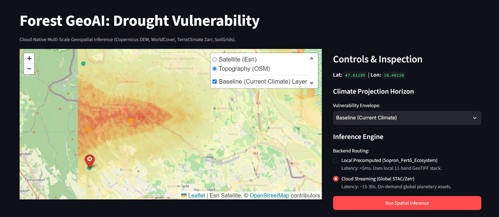
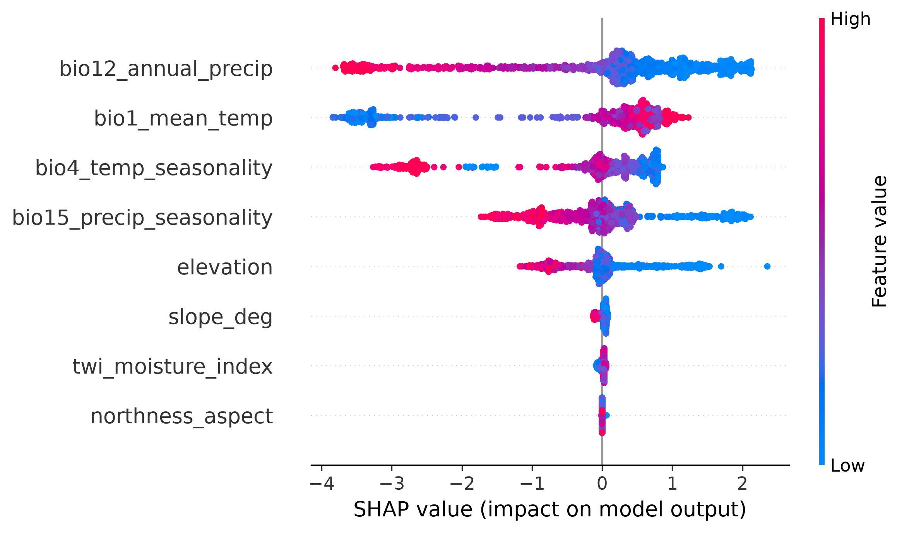

# Forest Vulnerability to Hotter Droughts: Multi-Scale Cloud-Native GeoAI Pipeline

[](https://github.com/DanilKras/ForestDroughtGeoAIPipeline/actions/workflows/ci.yml)
[](https://www.python.org/)
[](https://dvc.org/)
[](LICENSE)

An end-to-end, configuration-driven Geospatial Machine Learning pipeline designed to quantify, explain, and project **forest ecosystem vulnerability to hotter droughts and compound climate extremes** (focusing on Norway spruce, *Picea abies*).

The architecture bridges the scale gap by uniting **macro-scale regional bioclimatic vulnerability modeling (30 m)** with **micro-scale individual crown stress diagnostics (1 m)** across the Sopron–Fertő ecosystem (Hungary) and European spruce biomes.

---

## Interactive Dashboard & Model Attribution

| Real-Time Spatial Risk & SHAP Attribution | Global Factor Attribution (SHAP Beeswarm) |
| :---: | :---: |
|  |  |

> 🔗 **Video Walkthrough:** [Project Demonstration Video](https://drive.google.com/file/d/1ZfSfTBwKpOTrdrGbKoAzGnVFcybMXxF1/view?usp=sharing)

---

## Experimental Benchmarks & Validation

All macro-scale experiments are evaluated via **5-fold `StratifiedGroupKFold` over 150 km spatial blocks with a 15 km spatial guard buffer** (`guard_buffer_meters: 15000`) and a **strict pre-season temporal cutoff** (`< T-01-01`). The primary macro model quantifies **climatic drought exposure / hazard (`CWD >= Q60`)** using **strictly 8 pre-event topographic and climatic predictors**; post-event ESA WorldCover 2021 (`landcover_class == 10`) is excluded from primary model training and used strictly as an inference-time forest canopy mask (plus an explicit leakage diagnostic audit).

| Scale / Experiment | Predictor Set & Temporal Window | Evaluation Protocol | Measured Metric |
| :--- | :--- | :--- | :---: |
| **Macro Primary Exposure (`XGBoost`, 2018)** | **8 pre-event features**: Topo (4) + Climate (`BIO1`, `BIO4`, `BIO12`, `BIO15`, `< 2018-01-01`) | 5-Fold Stratified Spatial Block CV (150 km + 15 km guard) | **ROC-AUC: `0.9705 ± 0.0122`** (`PR-AUC: 0.9687`, `Brier: 0.0690`) |
| **Macro Linear Baseline (`LogReg`, 2018)** | Same 8 pre-event features | 5-Fold Stratified Spatial Block CV (150 km + 15 km guard) | **ROC-AUC: `0.9380 ± 0.0338`** (`Brier: 0.1015`) |
| **Macro Bagging Baseline (`RandomForest`, 2018)** | Same 8 pre-event features | 5-Fold Stratified Spatial Block CV (150 km + 15 km guard) | **ROC-AUC: `0.9726 ± 0.0138`** (`Brier: 0.0723`) |
| **Post-Event WorldCover Audit (Diagnostic)** | 9 features (+ ESA WorldCover 2021 `landcover_class`) | 5-Fold Stratified Spatial Block CV (leakage diagnostic) | **ROC-AUC: `0.9681 ± 0.0137`** (`Δ = -0.0025`, excluded) |
| **Macro Soil Ablation (2018)** | 10 features (8 primary + `soil_ph`, `soil_clay_percent` from SoilGrids 2.0) | 5-Fold Stratified Spatial Block CV (150 km + 15 km guard) | **ROC-AUC: `0.9738 ± 0.0107`** (`+0.0032`) |
| **Macro Static Terrain-Only Ablation** | 4 static Copernicus DEM features (**zero climate & zero landcover**) | 5-Fold Stratified Spatial Block CV (150 km + 15 km guard) | **ROC-AUC: `0.7164 ± 0.0948`** (`-0.2541`) |
| **Macro Spatial CV (2020 Drought)** | 8 pre-event features (climate `< 2020-01-01`) | 5-Fold Stratified Spatial Block CV (150 km + 15 km guard) | **ROC-AUC: `0.9555 ± 0.0241`** (`OOF: 0.9487`) |
| **Macro Disjoint Transfer (`2018 -> 2020`)** | 8 pre-event features across **spatially disjoint blocks** | Out-of-block & out-of-year (`n = 10,087`, 15 km guard) | **Mean Fold ROC-AUC: `0.6185 ± 0.1067`** (`Pooled: 0.5621`, $\rho_\text{CWD}=0.2059$) |
| **Micro Stand-Level `ΔNDMI` (Réde)** | Stand inventory (`FFJ_KOD`, `KOR`, `Magassag`, `TERULET`) vs 2022/2023 Sentinel-2 `ΔNDMI` | 5-Fold `StratifiedGroupKFold` (1 km + 60 m guard, `284` stands) | **ROC-AUC: `0.7252 ± 0.0512`** |
| **Hierarchical Macro–Micro Coupling (Réde)** | Copernicus GLO-30 + TerraClimate `macro_exposure_prior` × (`ΔNDMI` + `615,346` crowns) | Direct STAC/Zarr coupling across `284 / 284` stands (`EPSG:23700`) | **Exposure: `0.9287 ± 0.0053`** / **Risk: `0.2440 ± 0.1209`** |
| **Micro Crown Fusion & Ablations (Réde)** | UAV RGB (20 cm) + LiDAR CHM (1 m) + 6-band Sentinel-1/2 (`50 m` meso window) | Stand-grouped spatial blocks (`60 m` guard), train-only stats, val `F1` threshold | `python -m src.micro.train --run-ablations` (`fusion`, `rgb_only`, `chm_only`, `micro_rgb_chm`, `meso_only`, `rgb_meso`) |

### Key Methodological Highlights
- **Leakage-Free Exposure Framing:** Macro labels represent climatic drought exposure (`CWD >= Q60` vs `CWD <= Q40`), with climate predictors strictly truncated at `< T-01-01`. Post-event ESA WorldCover 2021 is withheld from training and applied solely as a forest canopy mask (`landcover_class == 10`) at inference.
- **Disjoint Spatiotemporal Generalization (`2018 -> 2020`):** Because 105 of 109 spatial blocks in 2020 overlap 2018 blocks, `evaluate_spatiotemporal_transfer` isolates strictly fold-disjoint 2020 blocks separated by a 15 km guard buffer, exposing realistic distribution shift between drought regimes rather than memorizing spatial coordinates.
- **Separating Allometric Tautology from Spectral Stress at Micro Scale:** `MultiScaleForestFusion` supports explicit modality ablations (`--modality` / `--run-ablations`) and two crown targets (`--target-mode allometry_zscore` vs independent `spectral_delta_ndmi` canopy moisture loss computed via Sentinel-2 `ΔNDMI`), isolating structural LiDAR circularity from genuine optical/SAR precursors.
- **Hierarchical Macro–Micro Coupling (`src.micro.multiscale_coupling`):** Bridges regional `macro_exposure_prior` (sampled directly for all 284 Réde stands via Copernicus GLO-30 DEM + TerraClimate Zarr with automatic IDW-KNN fallback) with stand-level `micro_sensitivity_score` (`ΔNDMI` + `615,346` crown stress rates) into `hierarchical_risk_index` (`data/03_results/rede_multiscale_stand_vulnerability.gpkg`).

---

## Multi-Scale Predictor Stack

### Macro-Scale Bioclimatic & Edaphic Drivers (30 m, `EPSG:3035` / `EPSG:4326`)

| Domain | Predictor Variable | Source / Resolution | Physiological / Ecological Mechanism |
| :--- | :--- | :--- | :--- |
| **Topography** | `elevation`, `slope_deg`, `northness_aspect`, `twi_moisture_index` | Copernicus GLO-30 (30 m) | Lapse rates, runoff velocity, solar insolation & moisture accumulation |
| **Macroclimate** | `bio1_mean_temp`, `bio4_temp_seasonality`, `bio12_annual_precip`, `bio15_precip_seasonality` | TerraClimate Zarr (`1995` to `T-1`) | Pre-season thermal regime, moisture budget & intra-annual seasonality |
| **Forest Mask (Inference Only)** | `landcover_class == 10` | ESA WorldCover 2021 (10 m) | Masks non-forest pixels during regional map generation (audited for leakage separately) |
| **Soil Properties (Ablation)** | `soil_ph`, `soil_clay_percent` | ISRIC SoilGrids 2.0 (250 m) | Rhizosphere biochemistry & capillary water-holding capacity (evaluated via ablation) |

### Micro-Scale Multi-Sensor Canopy Signals (1 m / Single Crown, `EPSG:23700`)

| Sensor Modality | Resolution | Extracted Feature Space | Physiological Function |
| :--- | :--- | :--- | :--- |
| **UAV LiDAR** | 1 m (Normalized `CHM`/`DRM`) | Crown radius, 3D height, allometric residuals | Physical crown thinning, top dieback & structural loss |
| **UAV Orthophoto** | 20 cm (RGB) | Local spectral texture & canopy openness | Visible needle chlorosis, defoliation & branch flagging |
| **Sentinel-1 SAR** | 10 m | Backscatter ($\sigma^0_\text{VV}, \sigma^0_\text{VH}$ in dB) | Dielectric permittivity & pre-visual canopy moisture loss |
| **Sentinel-2 MSI** | 10–20 m | `B04_Red`, `B08_NIR` (Baseline 04.00 `-1000` offset-corrected), `NDVI`, `NDRE`, `NDMI` | Water absorption bands & red-edge chlorophyll breakdown |

---

## Quick Start

### Environment & Data Setup (Windows PowerShell + `uv`)
```powershell
git clone https://github.com/DanilKras/ForestDroughtGeoAIPipeline.git
cd ForestDroughtGeoAIPipeline

$env:UV_CONCURRENT_INSTALLS = "1"
uv sync --link-mode=copy
dvc pull
```

### Launch Full Stack via Docker Compose
```powershell
docker compose up --build -d
```

| Service | Endpoint | Description |
| :--- | :--- | :--- |
| **Streamlit Dashboard** | `http://localhost:8501` | Interactive Leaflet vulnerability map & live SHAP breakdown |
| **FastAPI Inference API** | `http://localhost:8000/docs` | Dual-engine spatial inference OpenAPI documentation |
| **Airflow Webserver** | `http://localhost:8081` | Automated ETL, training & raster generation DAG |

### Standalone Pipeline Execution
```powershell
uv run python run_pipeline.py                  # Full macro-scale pipeline
uv run python run_pipeline.py --include-micro  # Macro + Réde Sentinel-2 + macro-micro coupling

uv run python -m src.macro.model_training      # 150 km Spatial CV, baselines, WorldCover audit & 2018->2020 transfer
uv run python -m src.micro.stand_drought_analysis
uv run python -m src.micro.multiscale_coupling
uv run python -m src.micro.train --modality rgb_meso --target-mode spectral_delta_ndmi
uv run python -m src.micro.train --run-ablations --target-mode allometry_zscore
uv run pytest -v
```

<details>
<summary><b>Repository Structure</b></summary>

```text
├── api/                # FastAPI dual-engine spatial inference service
├── config/params.yaml  # Single Source of Truth (predictors, bbox, hyperparameters)
├── dags/               # Apache Airflow orchestration DAG (pipeline_dag.py)
├── data/               # DVC-tracked raw, processed, micro_soe & result rasters/figures
├── frontend/           # Streamlit + Leaflet interactive XAI dashboard
├── models/             # Trained XGBoost (macro) & Cross-Attention Transformer (micro) weights
├── notebooks/          # Reproducible macro & micro EDA notebook (eda.ipynb)
├── run_pipeline.py     # Unified CLI pipeline entrypoint
├── src/
│   ├── macro/          # Regional ETL, CWD labeling, Spatial Block CV & GeoTIFF inference
│   └── micro/          # UAV LiDAR CHM, multi-sensor crown fusion, ablations & macro-micro coupling
├── tests/              # Spatial leakage, engineering, sanity audit & config validation tests
└── utils/              # Config loader, geospatial helpers, categorical schema & structured logger
```

</details>

---

## License

This project is licensed under the MIT License — see the [LICENSE](LICENSE) file for details.